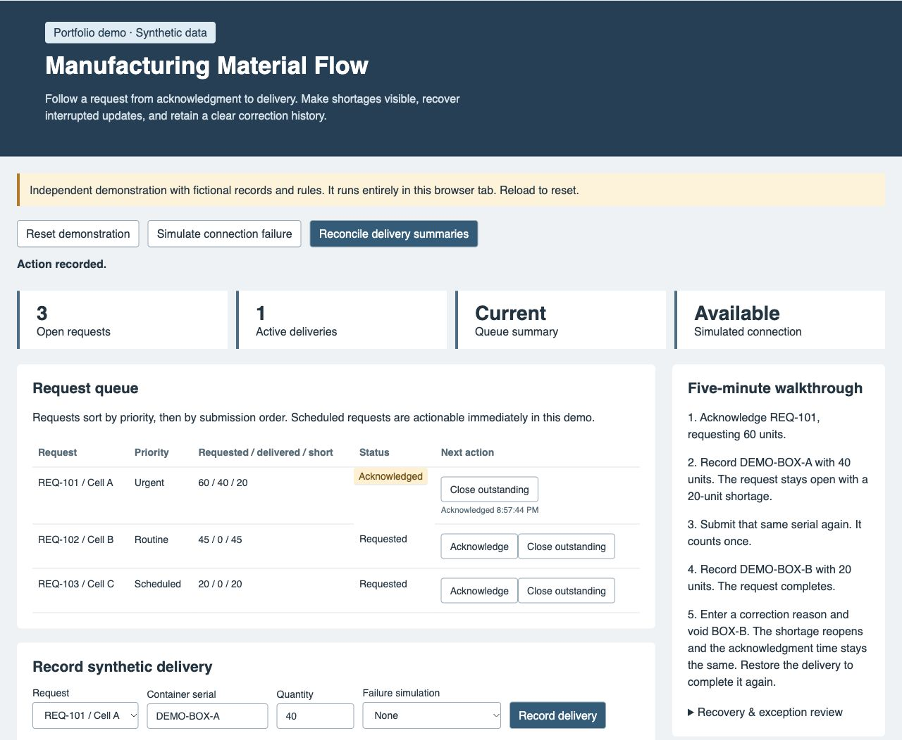

# Manufacturing Material Flow

A browser demo for tracking material requests on a shop floor. It shows what arrived, what is still outstanding, and how a repeated scan or an interrupted update affects the queue.



## Try the demo

Download or clone this repository, then open [index.html](index.html) in your browser. The demo runs from the local files. Reload the page to start over.

1. In **Request queue**, acknowledge **REQ-101**, a request for 60 units.
2. In **Record synthetic delivery**, use **REQ-101**, serial **DEMO-BOX-A**, and quantity **40**. Click **Record delivery**. The queue shows **60 requested, 40 delivered, and 20 short**.
3. Click **Record delivery** again with the same serial. The box counts once, and the queue still shows **20 short**.
4. Change the serial to **DEMO-BOX-B** and the quantity to **20**. Record the delivery to complete the request.

To see a correction, enter a fictional reason such as “Wrong container” under **Delivery evidence** and void **DEMO-BOX-B**. The 20-unit shortage reopens. Restore the delivery to complete the request again.

If your browser restricts scripts in local files, run `python3 -m http.server 8000 --bind 127.0.0.1` in the repository folder and open `http://127.0.0.1:8000` in your browser.

## How it works

[The workflow engine](engine.js) builds queue totals from active delivery records. It uses container serials to recognize retries and keeps the original delivery record when a correction changes its status. Closure requires a connection, and the engine checks the quantity range before recording or restoring a delivery.

Use the [browser controls](app.js) to simulate an interrupted response or summary update. The queue flags a stale total until you reconcile the summaries or retry the saved serial.

This independent, AI-assisted demo uses fictional requests, containers, and operators. It models one in-memory browser session. “Short” means units still owed on a request.

## Run the tests

Open a terminal in the repository folder and run the following command. The suite uses the built-in test runner and was verified with Node.js 20.

```sh
node test.cjs
```

The [11 test scenarios](test.cjs) cover partial deliveries, duplicate scans, corrections, failed updates, lost responses, closure, connection loss, quantity validation, and repeated submissions. Two regression tests check that an offline closure leaves the request open and that an out-of-range restore preserves the delivery and summary state.
